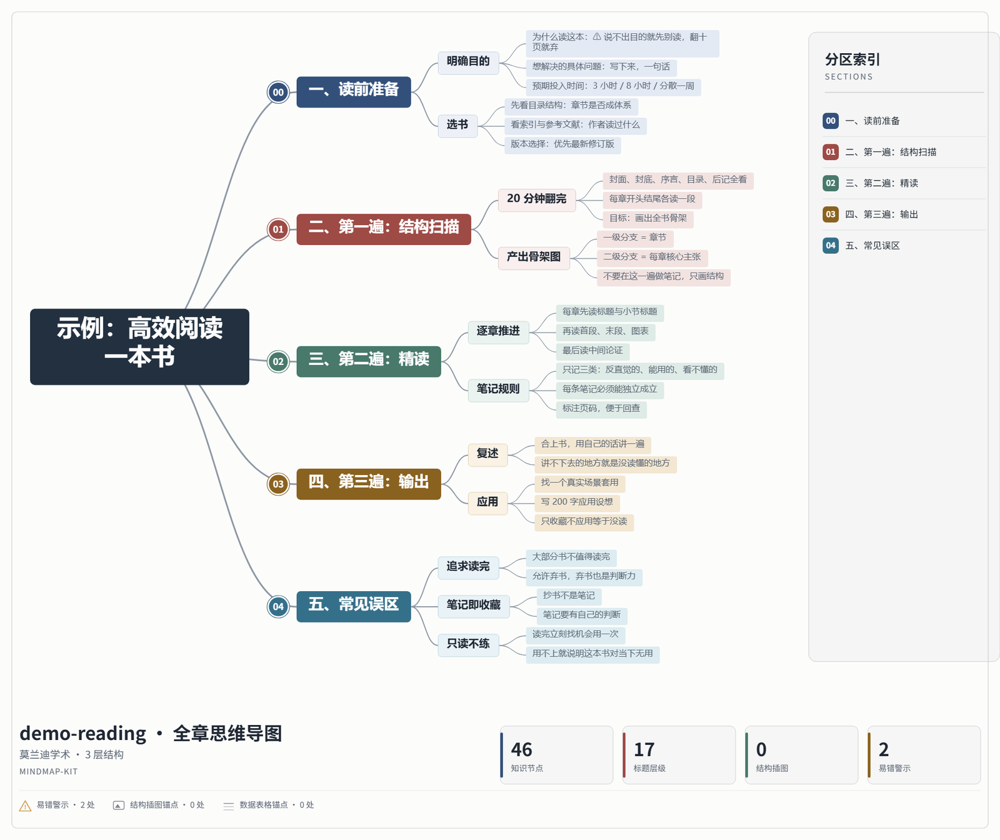
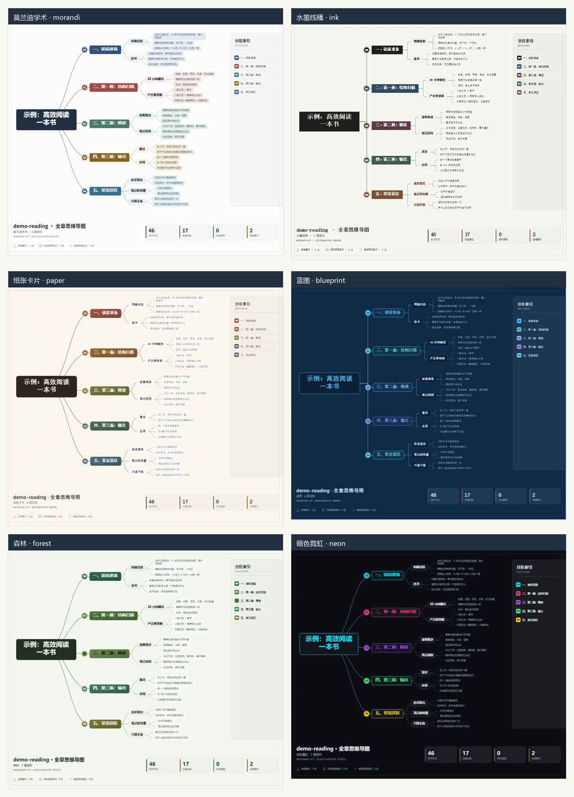
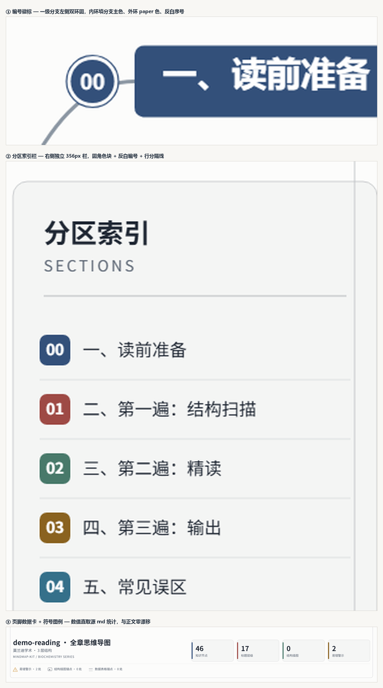

# mindmap-kit · Markdown → 出版级思维导图

> 一条命令，把 Markdown 笔记变成可交付的三件套：**矢量 SVG**（可再编辑）+ **单页 PDF**（文字可选中、可搜索）+ **预览 PNG**。
> 内置 6 套设计主题、四层装饰、八项质量门禁。纯本地执行，不联网、不上传。

[](#许可)




<sub>↑ 真实产物：46 节点示例，`--theme morandi --decorate full`。左边是脑图本体，右边是分区索引栏，底部是数据卡与符号图例。**这是从 PDF 直接栅格化的，不是效果图。**</sub>

---

## 它解决什么问题

市面上的脑图工具分两类，各有硬伤：

- **在线工具**（XMind / 幕布 / ProcessOn）——好看，但要登录、要联网、导出带水印或限页，且**样式是它定的**，你只能选它给的模板。
- **代码化工具**（markmap / mermaid / jsmind）——写得快，但**只能出网页**，导 PDF 要额外折腾；节点样式受 Markdown 语法限制，做不出"能贴进教材/讲义"的出版级排版。

`mindmap-kit` 走第三条路：**Markdown 当源文件，SVG 当中间产物，PDF 当交付物**。

关键差别在于——它不是"把 Markdown 渲染成网页"，而是**自己接管排版**：

1. 用 [simple-mind-map](https://github.com/wanglin2/mind-map) 算出节点几何与连线（这部分它做得比谁都好）；
2. 把每个节点里的 `<foreignObject>` HTML **拍平成原生 `<text>`**（这是能出正确 PDF 的根本原因，见下文「一个必须知道的坑」）；
3. 在空白区叠加编号徽标、分区索引栏、页脚数据卡、符号图例四层装饰；
4. 用 Chrome 无头打印出**单页矢量 PDF**，文字可选中、可搜索、可复制。

所以产物是「一份能直接印进讲义的设计稿」，不是「一张网页截图」。

---

## 快速开始

```bash
git clone https://github.com/ccyk-hash/mindmap-kit.git
cd mindmap-kit

bash bin/mmk doctor                                    # 环境自检，先看这个
bash bin/mmk build examples/demo-reading.md \
                --theme morandi -o out/demo            # 出 SVG + PDF + PNG
bash bin/mmk audit out/demo                            # 八项质量门禁
```

实测输出（46 节点示例）：

```
· parse     46 节点 / 深度 3 / 警示 2 / 图 0 / 表 0
· render    1459×1291 px  (1.4s)  svg 53 kB  文字拍平 46 处 / 48 行
· decorate  装饰后 1861×1563 px  分区 5 个  [full]
· pdf       √ pages=1 1396×1172pt 文字 722 字符  (1.7s)
· png       558×469 px  (1.2s)
√ build    out/demo   总耗时 4.5s

[OK]   PDF 交付     pages=1 1396.08×1171.92pt 文字 722 字符
[OK]   标题覆盖率   H2 100.0%（5/5）· H3 100.0%（11/11）
VERDICT: OK   OK 8 / WARN 0 / FAIL 0
```

`bin/mmk` 是**路径无关**的：放到任意目录、从任意 cwd 调用都能跑。它会自己挑一个能用的 Python 解释器（`$MMK_PYTHON` → `python3`/`python`/`py` → 常见安装路径），找不到就明确报错并告诉你怎么指定。

---

## 六套主题



<sub>↑ 同一份 Markdown（`examples/demo-reading.md`），只换 `--theme`。差异是全维度的：字体、形状、圆角、纹理、填充策略、明暗。</sub>

| 主题 | 气质 | 底色 | 正文字色 | 节点形状 | 纹理 | 适合 |
|---|---|---|---|---|---|---|
| `morandi` | 莫兰迪学术 | `#FCFCFB` | `#1F2733` / `#5A6472` | 全圆角 | — | 默认首选，正式讲义、论文配图 |
| `ink` | 水墨线稿 | `#F7F5F0` | `#1E1E1C` / `#55534E` | 全直角 | 纸纹 | 打印稿、黑白复印不失真 |
| `paper` | 纸张卡片 | `#FBF6EC` | `#2C2620` / `#6B6157` | 圆角 14/12/10/8 | 纸纹 | 暖色调、长文阅读 |
| `blueprint` | 蓝图 | `#0E2A47` | `#D8E8F5` / `#93B3CC` | 全圆角 | 网格 | 技术文档、架构图 |
| `forest` | 森林 | `#F4F7EF` | `#22301F` / `#5A6B52` | 全圆角 | 圆点 | 生物/生态/科普 |
| `neon` | 暗色霓虹 | `#0B0D12` | `#E6ECF5` / `#8B97A8` | 全圆角 | 噪点 | 屏幕演示、暗色环境 |

字号阶梯固定为 `44 / 28 / 20 / 16 / 14 px`（root / 二级 / 分支 / 叶子 / 标签），`--font-scale` 只允许 `0.85~1.15` 微调，防止把阶梯调乱。

主题是 **JSON 数据，不是代码**——`kit/themes/*.json` 里改 `paper` / `ink` / `branches[14].main` 即可换色，不需要碰渲染逻辑。每套主题 14 组分支配色，每组 `{name, main, deep, pale, mist, edge}`。

```bash
bash bin/mmk themes list          # 看六套
bash bin/mmk themes show morandi  # 看某套的完整令牌
```

---

## 四层装饰



| # | 装饰 | 位置 | 说明 |
|---|---|---|---|
| ① | 编号徽标 | 一级分支左侧 | `r=21` 双环圆，内环填分支主色、外环 paper 色、反白序号 |
| ② | 分区索引栏 | 右侧独立 356px 栏 | 色块 + 反白编号 + 行分隔线，长图导航用 |
| ③ | 页脚数据卡 | 底部 272px | 4 张卡，数值**直取源 md 统计**，与正文零漂移 |
| ④ | 符号图例 | 页脚左侧 | 三角=易错警示、空心框=结构插图锚点、三横线=数据表格锚点 |

**设计三原则**（写死在代码注释里）：

1. **不碰节点几何**——simple-mind-map 的布局已定死，装饰只往空白区长：向右 `W+46`、向下 `H+34`。
2. **只产原生 `<text>`**——装饰文字不过 `foreignObject`，保证 PDF 里能选中。
3. **主题无关**——颜色从 `paper` / `ink` / `inkSoft` / `branches` 派生，`_is_dark(paper)` 阈值 0.42 自动翻转明暗。

按需开关：

```bash
--decorate none     # 全关，只要纯脑图
--decorate badges   # 只要编号徽标
--decorate index    # 徽标 + 索引栏
--decorate footer   # 徽标 + 页脚数据卡 + 图例
--decorate full     # 全开（默认）
```

---

## 八项质量门禁

`audit` **只读产出文件**（SVG + PDF + report.json），不信 build 的自述。退出码 `0` 非 FAIL / `1` 有 FAIL / `2` 找不到基准——可以直接挂在 CI 上阻断。

| # | 项目 | 阈值 |
|---|---|---|
| 1 | 画布规模 | 只报数不判（用于横向对比） |
| 2 | 字号档位 | ≤5 档，级差 ≥2px |
| 3 | 连线阶梯 | ≥3 级（3.0 / 2.0 / 1.3 的「3-2-1 律」） |
| 4 | 单行长度 | 标签 ≤20em，硬上限 32em（描述层只计数） |
| 5 | WCAG 对比度 | 正文 ≥4.5:1，≥24px 大字 ≥3:1 |
| 6 | 文字溢出 | 0 处（独立复算文字宽度 vs 节点宽度） |
| 7 | PDF 交付 | 单页 + MediaBox ≤14400pt + 文字 ≥50 字符 |
| 8 | 标题覆盖率 | H2 100%，H3 ≥95% |

阈值集中在 `kit/audit.py` 的 `THRESHOLDS` 字典，改门禁只改这一处。

### 基准快照回归

```bash
bash bin/mmk audit out/demo --save-golden v1
# ...改主题 / 改样式 / 改 md...
bash bin/mmk audit out/demo --compare-golden v1
```

输出形如：

```
· WCAG 对比度.worstRatio: 4.81 → 3.34 (-1.47)
· 连线阶梯.levels: [1.3, 2, 3] → [1.2, 2, 3]
· PDF 交付.height_pt: 1171.92 → 1213.92 (+42.00)
```

只比归一化指标（比值、档位、计数），不比绝对像素——所以换主题后仍能看出「哪些设计指标真的变了」。

---

## 命令速查

```bash
bash bin/mmk doctor                          # 环境自检
bash bin/mmk --version                       # mmk 0.1.0
bash bin/mmk themes list|show NAME           # 主题管理
bash bin/mmk build SRC.md [选项]             # 构建
bash bin/mmk audit TARGET [选项]             # 质量门禁
```

`build` 选项：

| 参数 | 取值 | 默认 |
|---|---|---|
| `--theme` | 六套之一 | `morandi` |
| `--layout` | `tree` / `balanced` / `org` / `fishbone` / `timeline` / `catalog` | `tree` |
| `--font-scale` | `0.85~1.15` | `1.0` |
| `-o, --out` | 产出目录 | `out/<源文件名>` |
| `--decorate` | `none`/`badges`/`index`/`footer`/`full` | `full` |
| `--meta-line` | 页脚 meta 行文字 | `MINDMAP-KIT / BIOCHEMISTRY SERIES` |
| `--png-scale` | PNG 缩放 | `0.3` |
| `--png-max-px` | PNG 最长边上限 | `14000` |
| `--no-pdf` / `--no-png` | 跳过对应产物 | — |
| `--keep-tmp` | 保留临时渲染目录 | — |

`audit` 的 target 可以是**产出目录**（推荐）、`.svg`、或 `.pdf`：

- 给目录 → 八项全跑
- 给 `.svg` → 六项（缺 PDF 交付与标题覆盖率，可补 `--source`）
- 给 `.pdf` 且同目录有同名 `.svg` → 自动配对，八项全跑
- 给 `.pdf` 但无同名 `.svg` → 直接 FAIL 并提示改传目录

---

## Markdown 怎么写

```markdown
# 章标题（→ 根节点）

## 一、一级分支（→ 一级分支节点）

### 1. 二级要点

- 三级要点
  - 四级细节
    - 叶子描述可以写长一点，会自动折行

⚠ 以 ⚠ 或 ⚠️ 开头的列表项 → 标记为「易错警示」，页脚会统计数量
（图2-5）→ 自动识别为结构插图锚点，编号在节点里加粗
（表2-3）→ 自动识别为数据表格锚点
```

**四条必须知道的解析规则**（都是实测出来的，不是设计意图）：

1. **普通段落默认被丢弃**，不会附着到最近节点。要保留的内容必须写成列表项。这是为了防节点爆炸——一篇文章的正文段落全塞进图里就没法看了。
2. **一个节点只挂一个 tag，图号优先**。同一行写 `（图3-7）参见（表3-2）`，只会记 `fig 3-7`，表号被吞。要两个都记，拆成两行。
3. **表格行会被跳过**（`| a | b |`），只统计数量，不进图。
4. **粗体与行内代码保留**：`**粗体**`、`` `code` `` 会带到 SVG 里并正确拍平。

---

## 一个必须知道的坑（也是本项目的核心）

**Chrome 158 的 `--print-to-pdf` 对 `<foreignObject>` 内 HTML 的多行排版，只保住第一行。**

这不是 PyMuPDF 的 bug，用 `pdftoppm` 把 PDF 转回图交叉验证过——PDF 本身就只有第一行。调 CSS、去 transform、改单位、换字体，全部无效。

所以 `kit/svgtext.py` 干的事是：**把每个 `<foreignObject>` 里的 HTML 布局结果，重新用原生 `<text>` + `<tspan>` 排一遍**。

具体做法（`flatten(svg) -> (svg, stats)`）：

1. 解析 foreignObject 内的 `style`，拿到 `font-size` / `font-weight` / `font-family` / `width`；
2. 把所有富文本 run 摊平成**单字符流** `[(ch, bold, mono), ...]`；
3. 按 `\n` 切段，逐段标合法断点（中文可断、ASCII 词内禁断、标点禁行首/行尾、图号表号整体禁断）；
4. 用 PIL 按真实字体量宽，贪心断行 + 回退到 `last_legal`；
5. 输出 `<text>` + `<tspan font-weight="bold">`，基线按 `_ASCENT=1.058` / `_DESCENT=0.262` 算。

这一步是整个流水线能出正确 PDF 的根本原因。**任何改动都不能绕过它。**

配套的两个细节，都是踩出来的：

- **`foreignObject` 的 `width` 有两种语义**：顶满 `max-width` 时它是「上限」（要用 `box_w * 0.98` 才断对），文字较短时它是「精确内容宽」（要用 `box_w * 1.02`）。判别靠 `_max_width(inner)` 正则。
- **`style` 属性必须先 `html.unescape` 再按顶层分号拆**——浏览器序列化出来的字体名带 `&quot;`，直接 split 会把 `font-family` 截成 `&quot`。

---

## 目录结构

```
mindmap-kit/
├── SKILL.md                    # 给 AI agent 看的技能说明（11 节）
├── bin/mmk                     # 路径无关的 bash 入口
├── kit/
│   ├── cli.py                  # 命令行装配
│   ├── parse.py                # Markdown → 节点树（语义标记识别）
│   ├── render.py               # 节点树 → SVG（驱动 simple-mind-map）
│   ├── svgtext.py              # ★ foreignObject 拍平成原生 <text>
│   ├── decorate.py             # 四层装饰
│   ├── audit.py                # 八项质量门禁
│   ├── export.py               # SVG → PDF / PNG（Chrome 无头）
│   ├── chrome.py               # Chrome 发现、临时目录、打印
│   ├── doctor.py               # 环境自检
│   ├── ab_card.py              # 装饰层 A/B 对比卡
│   └── themes/*.json           # 六套主题令牌
├── templates/
│   ├── render.html             # 渲染页（含主题引擎、装饰背景层）
│   └── print.html              # 打印页
├── vendor/smm/                 # simple-mind-map 0.14.0-fix.3（UMD，file:// 直开）
├── examples/demo-reading.md    # 46 节点示例
├── golden/demo.json            # 基准快照
└── docs/images/                # README 用图
```

代码规模约 3,300 行 Python（其中 `audit.py` 728 行、`svgtext.py` 500 行、`decorate.py` 450 行）。

---

## 性能参考

| 规模 | 节点数 | 画布 | 端到端 |
|---|---|---|---|
| 单篇笔记 | 46 | 1861×1563 | **4.5s** |
| 教材一章 | 264 | 2701×10093 | 6.4s |
| 教材大章 | 467 | 2639×21036 | 6.3s |
| 教材整章（密集） | 702 | 2943×26951 | 6.5s |

瓶颈在 Chrome 无头启动（每次约 1.4s）与打印（约 1.7s），纯 Python 部分不到 1s。`--no-pdf --no-png` 单次约 1.6s，适合调样式时快速预览。

超大图（高 > 14400pt）会自动等比缩小到 PDF 规范允许的 MediaBox 上限内，保持单页 + 矢量——不会出现「第 2 页只有一条线」这种事故。

---

## 依赖

| 依赖 | 用途 | 必需 |
|---|---|---|
| Python ≥ 3.8 | 运行 | ✅ |
| Chrome / Chromium | 无头打印 PDF + 截图 PNG | ✅ |
| PyMuPDF | 校验 PDF 页数与文字层 | ✅ |
| Pillow | 文字量宽、A/B 对比卡 | ✅ |
| 中文字体（雅黑/宋体/黑体/等线） | 排版 | ✅ |

`bash bin/mmk doctor` 会逐项检查并给出 `OK` / `WARN` / `FAIL`。缺了会明确告诉你缺什么，不会静默降级。

---

## 作为 AI agent 技能使用

`SKILL.md` 是给 Claude Code / DeepSeek Harness / WorkBuddy 这类 agent 读的技能说明，含触发条件、命令速查、主题决策树、常见故障表。装到对应目录即可：

```bash
# DeepSeek Harness / WorkBuddy
cp -r mindmap-kit ~/.workbuddy/skills/mindmap-kit
# Claude Code
cp -r mindmap-kit ~/.claude/skills/mindmap-kit
```

之后直接说「用 mindmap-kit 把这份 md 出成莫兰迪脑图」即可触发。

---

## 已知限制

- **单页输出**。超过 14400pt 会自动缩，不自动分页——超长章节请先用 `##` 拆成多份。
- **不做交互**。产物是静态 SVG/PDF，没有折叠展开、没有动画。要交互请直接用 simple-mind-map 本体。
- **中文字体依赖系统**。Linux 上需要自己装思源/Noto CJK，`doctor` 会提示。
- **装饰位置按几何推算**，不读内容语义。极端窄长的图（宽高比 > 8:1）索引栏可能显得空。
- **`audit` 的文字量宽用 PIL 近似**。含 `₃` `⁵` `×` 等 fallback 码位时会有 2~6% 偏差，已用 5% 容差吸收，不会误报。

---

## 许可

代码 MIT。`vendor/smm/` 下的 simple-mind-map 为 [MIT](https://github.com/wanglin2/mind-map/blob/main/LICENSE)，版权归原作者。

主题配色与装饰设计为本项目原创。
